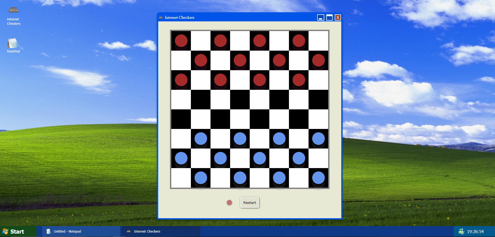

# 🎮 Checkers Game

A modern implementation of the classic checkers game built with React and Vite, featuring a Windows-style interface.



## ✨ Features

- 🎲 8x8 game board
- 👥 Two-player gameplay (N1 and N2)
- ♟️ Piece movement and capture mechanics
- 🔄 Turn-based system
- 🟤 Visual piece representation with Brown and blue tokens
- 🖱️ Interactive board interface

## 🛠️ Technologies Used

- ⚛️ React
- ⚡ Vite
- 💻 JavaScript
- 🎨 CSS
- 📦 Lodash (for utility functions)

## 🚀 Getting Started

### 📋 Prerequisites

- Node.js (v14 or higher)
- npm or yarn

### ⚙️ Installation

1. Clone the repository:
```bash
git clone https://github.com/Mauricio650/Damas.git
```

2. Navigate to the project directory:
```bash
cd Damas
```

3. Install dependencies:
```bash
npm install
# or
yarn install
```

4. Start the development server:
```bash
npm run dev
# or
yarn dev
```

5. Open your browser and visit `http://localhost:5173`

## 🎯 How to Play

1. The game starts with Player N1 (brown pieces)
2. Click on a piece to select it
3. Click on a square to move your piece
4. Capture opponent pieces by jumping over them
5. Players alternate turns

## 📜 Game Rules

- Pieces can only move diagonally forward
- Regular pieces can only move one square at a time
- Pieces can capture opponent pieces by jumping over them
- The game continues until one player captures all opponent pieces

## 🔮 Future Features

- 👑 Queen Promotion: Pieces will become queens when reaching the opposite end of the board
- 🎯 Multiple Capture: Ability to capture multiple pieces in a single turn
- 🎨 Customizable Board: Change board colors and piece designs
- 🎮 Game Modes: Different game variations and difficulty levels
- ⏱️ Timer: Add time limits for each player's turn
- 📊 Score System: Track wins and losses
- 🎵 Sound Effects: Add game sounds for moves and captures
- 🌐 Online Multiplayer: Play against friends online
- 🤖 AI Bots: Play against computer opponents with different difficulty levels
- 📱 Mobile Support: Optimize for mobile devices
- 🏆 Leaderboard: Track top players and their scores

## 📁 Project Structure

```
├── src/
│   ├── components/         # Static assets
│   │   ├── IconsDesktop.jsx    # Desktop icons component
│   │   ├── ToolBar.jsx         # Game toolbar component
│   │   └── WindowsHeader.jsx   # Window header component
│   ├── styles/         # CSS styles
│   │   ├── App.css            # Main application styles
│   │   ├── IconsDesktop.css   # Desktop icons styles
│   │   ├── ToolBar.css        # Toolbar styles
│   │   ├── windowsHeader.css  # Window header styles
│   │   └── index.css          # Global styles
│   ├── App.jsx         # Main game component
│   └── main.jsx        # Application entry point
├── public/             # Public assets
├── index.html          # HTML template
├── vite.config.js      # Vite configuration
├── eslint.config.js    # ESLint configuration
└── package.json        # Project dependencies
```

## 💻 Development

This project uses:
- Vite as the build tool
- ESLint for code linting
- React for the UI framework

## 🤝 Contributing

Feel free to submit issues and enhancement requests!

## 📄 License

This project is licensed under the MIT License - see the LICENSE file for details.